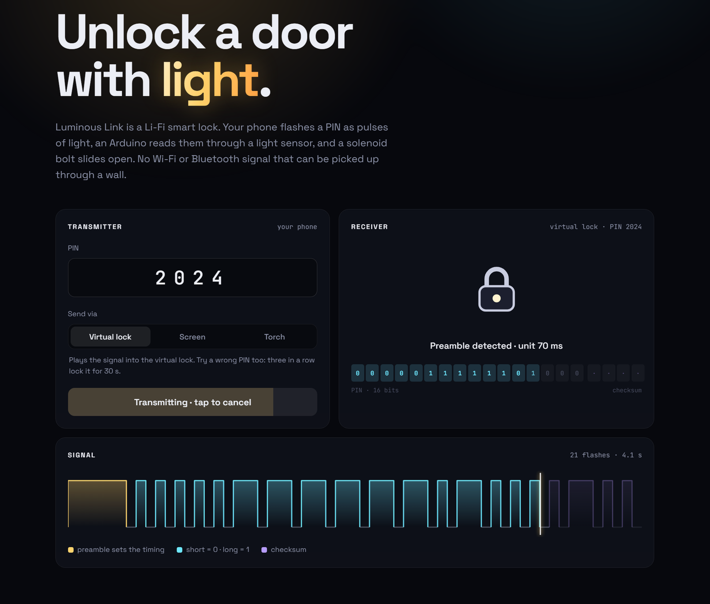
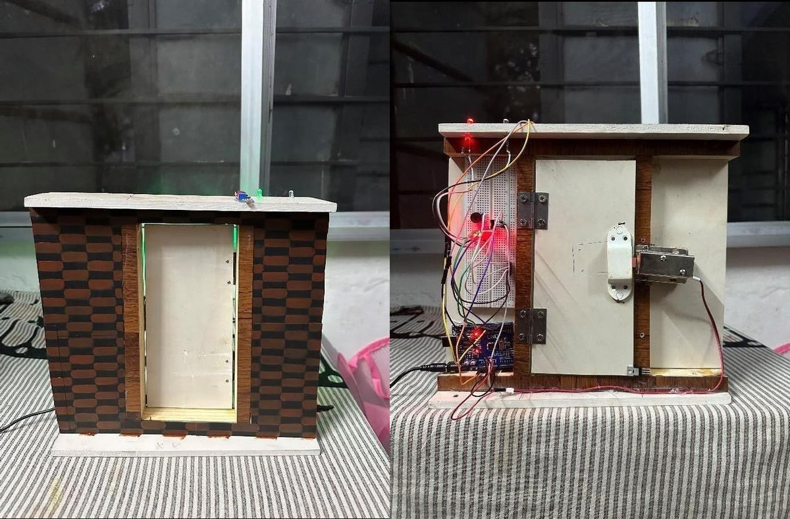
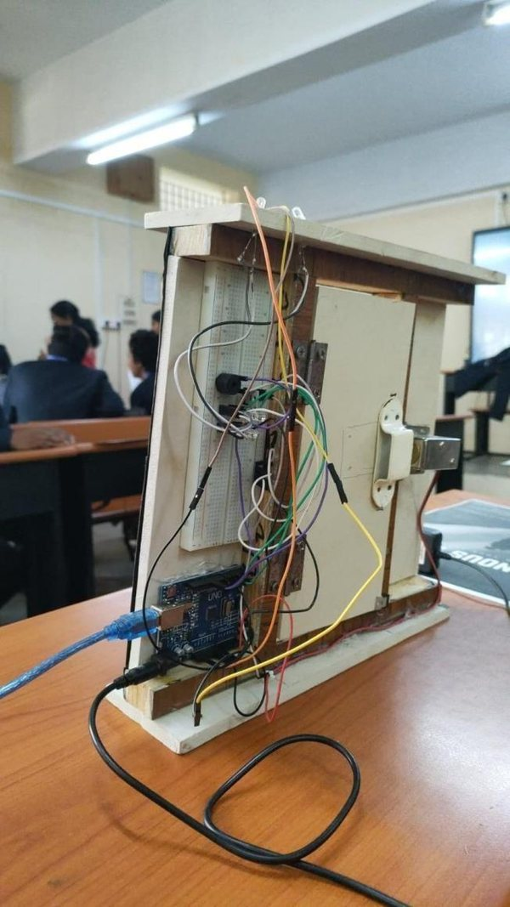
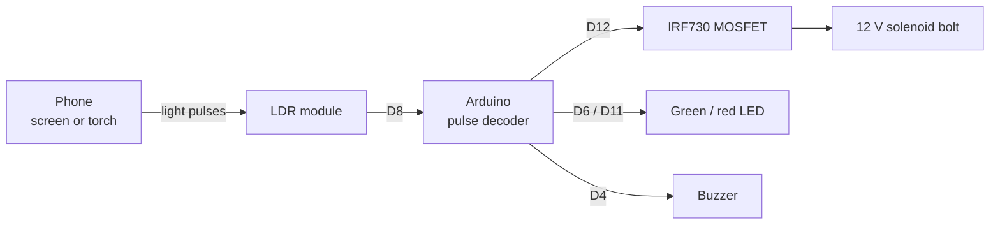
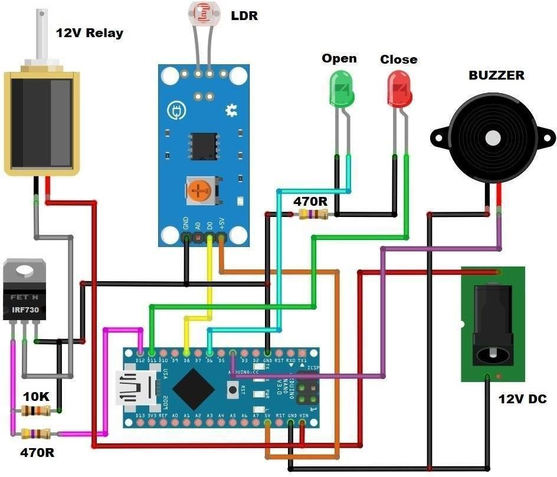

<div align="center">

# Luminous Link

**Unlock a door with light.** A Li-Fi smart lock built on Arduino.

[](https://github.com/AdwaithSaji/Luminous-Link/actions/workflows/ci.yml)
[](https://adwaithsaji.github.io/Luminous-Link/)

[](LICENSE)

🏆 **1st place, TECHSCAPE 2024**: science and IoT exhibition held by the Division of CSE, Karunya Institute of Technology and Sciences

[**Try the live demo →**](https://adwaithsaji.github.io/Luminous-Link/)



</div>

## What it is

Your phone flashes a 4-digit PIN as pulses of light. A light sensor (LDR) on the door feeds them to an Arduino, which times each pulse, checks the PIN and pulls back a 12 V solenoid bolt.

There's no Wi-Fi or Bluetooth signal that can be picked up through a wall, and no app to install. The transmitter is a web page that flashes either the screen or the phone's torch.

This was my first engineering project. I built it during my B.Tech in CSE, and it took 1st place at the department's TECHSCAPE 2024 exhibition. This repo is a cleaned-up version: a proper light protocol, a lockout after wrong PINs, tests, and a transmitter anyone can try in the browser.

<p align="center">
  
  
</p>

## How it works



### The light protocol

Each frame is a long **preamble** flash, then **20 data flashes**: a 16-bit PIN and a 4-bit checksum. A short flash is a `0` and a long one is a `1`.

| Segment   | Duration (units) |
|-----------|------------------|
| Preamble  | 6                |
| Gap       | 1 (dark)         |
| `0` flash | 1                |
| `1` flash | 2.5              |

The receiver **learns the unit from the preamble**, so the same lock works with a fast screen (70–100 ms per unit) and a slower phone torch (~160 ms). The thresholds are deliberately wide: the decoder still reads the PIN with ±30% jitter on every flash, and the tests check this.

On the lock side:

- **Wrong PIN:** a low buzz and the red LED stays on.
- **3 wrong PINs:** a 30-second lockout, with the red LED blinking.
- **Checksum mismatch:** the frame is dropped. Bad reception doesn't count as a wrong PIN.
- **Steady room light or brief flicker:** ignored.

## Hardware

| Part                   | Pin | Role                         |
|------------------------|-----|------------------------------|
| Arduino Uno / Nano     |     | decoder and control          |
| LDR module (LM393)     | D8  | light sensor (digital out)   |
| IRF730 MOSFET          | D12 | switches the 12 V solenoid   |
| 12 V solenoid lock     |     | the bolt                     |
| Green LED + 470 Ω      | D6  | open                         |
| Red LED + 470 Ω        | D11 | closed / lockout             |
| Buzzer                 | D4  | feedback and alarm           |
| 12 V DC adapter        |     | powers the solenoid          |

<details>
<summary>Wiring diagram</summary>
<br>

</details>

## Getting started

### Firmware

1. Open [`firmware/luminous_link`](firmware/luminous_link) in the Arduino IDE.
2. Set your PIN in [`config.h`](firmware/luminous_link/config.h) (default `2024`).
3. Upload to an Uno or Nano. Open the Serial Monitor at 9600 baud to watch frames decode.
4. Turn the LDR module's trim pot until its LED switches on with a phone light and off in room light.

Or with `arduino-cli`:

```bash
arduino-cli compile --fqbn arduino:avr:uno firmware/luminous_link
arduino-cli upload  --fqbn arduino:avr:uno -p COM3 firmware/luminous_link
```

### Web transmitter

The page has no build step and no dependencies. Serve the `web/` folder:

```bash
npm start            # or: python -m http.server -d web
```

Open it on your phone, choose **Screen** or **Torch**, and hold the phone to the sensor. Torch mode needs Chrome on Android over HTTPS (the GitHub Pages site works).

### Tests

```bash
npm test
```

The tests run the transmitter's encoder against the decoder. They cover speeds from 40 to 400 ms per unit, 200 jittered runs, the lockout, checksum failures, timeouts and ambient-light rejection. CI also compiles the firmware for the Uno and the Nano.

## Project layout

```
firmware/luminous_link/   Arduino sketch (decoder + lock control) and config.h
web/                      transmitter + virtual lock (vanilla JS, deployed to Pages)
web/protocol.js           protocol spec and reference decoder, mirrored in the sketch
tests/                    node:test suite for the protocol
docs/images/              photos and wiring
```

## Limitations

This is a student prototype, and it has real security limits:

- **Replay.** A camera that records the flashes can replay them. Rolling codes, where the PIN changes every unlock, would fix this.
- **Line of sight.** Light needs a direct path. That stops eavesdropping through a wall, but it also means bright sunlight can saturate the LDR.
- **Brute force.** Guessing is slowed only by the 30-second lockout.

## Roadmap

- [ ] Rolling codes (HOTP-style counter shared between the phone and the lock)
- [ ] ESP32 version with a status page and an unlock log
- [ ] Face recognition as a second factor (ESP32-CAM)
- [ ] Photodiode receiver for faster, longer-range links

## Author

**Adwaith Sajikumar** ([@AdwaithSaji](https://github.com/AdwaithSaji))

Supervised by Dr. R. Priscilla Joy, Division of CSE, Karunya Institute of Technology and Sciences, Coimbatore.

## License

[MIT](LICENSE)
